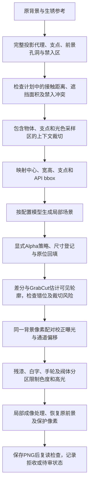

# 受控融合 0.4.0 / Prompt 2.2：穿模、接触与环境光色修订

日期：2026-10-15。分支：`codex/manual-driven-scene-fusion`。

## 1. 本次依据和实际完成范围

本次直接查看了原背景、Prompt 2.1复测的气瓶和阀门原始预览，读取复测记录和实际请求。两张预览中仍有接触不清晰、交叉层级不稳定、亮红/亮蓝残漆与局部成像不协调的问题。

运行记录显示，两张都是2730×1536 RGBA PNG，Alpha最小251；旧适配器在Alpha检查处停止。它们是服务返回文件的原样副本，**没有经过后处理、背景恢复或正式验收**。旧任务的完整物体/接触/原前景Mask为空，局部校色为`none`。不能把这些旧图解释为“局部校色后依然无效”。

本次完成程序和配置修改、静态检查、离线规划、离线请求构建及提示词导出。用户追加授权后，调用私有配置中的视觉模型辅助审阅代码与证据图。**没有发起新的图像生成，没有把旧图重新加工成新版效果样本，也没有测出新版自然融合成功率。**模型审阅属于辅助意见，调用与采纳情况单独记录。

### 证据分层

| 内容 | 性质 |
|---|---|
| 原背景、参考图哈希及原始复测PNG通道/尺寸 | 可读取的文件事实 |
| 局部采样RGB中位数 | 对原图指定像素区域的统计观测 |
| 物体投影代理、斜钢条轮廓、镂孔、支点、承托区、禁入带 | 建议性二维控制，`proposal / confirmed=false` |
| 尺度、实际承重、三维占据、重心及隐蔽结构 | 尚未核验 |
| GrabCut返回轮廓 | 后续处理时的估计，仅作辅助拒收，不是实际完整轮廓或训练标注 |
| 生图模型采样、潜变量、内部去噪、隐藏光照计算 | 未开放，不作执行事实描述 |

## 2. 新流程与旧流程的差别



当前Wan适配器仍然只向模型提交参考图、场景裁切、文本和bbox；**没有声称提交原生二值inpaint、深度图或法线图**。Mask在本地用于规划、诊断、处理范围及原像素恢复。模型遵循bbox和文本的程度仍需检查。

## 3. 算法一：带上下文的局部生成与坐标回映射

新增`generator.context_crop`和`context_padding_ratio`。裁切范围包括全部目标OBB、允许编辑/接触区和配对采样区，再向外保留上下文，并尽量保持原图长宽比。范围太大时明确回到整图，不丢失声明的控制范围。

设原图宽高为`W,H`，裁切左上角为`x0,y0`，裁切尺寸为`wc,hc`：

```text
xc = (x * W - x0) / wc
yc = (y * H - y0) / hc
width_c  = width_original_normalized * W / wc
height_c = height_original_normalized * H / hc
```

物体像素比例和图像平面旋转角保留。API bbox先在原图计算旋转OBB，再减裁切原点并按实际发送尺寸缩放。提示词中的中心、宽高和接触点同步转换，明确使用“当前输入图”坐标。TXT、结构化Prompt和真实请求共用同一份文本。

服务返回的局部图按显式`output_registration`策略登记为裁切尺寸，再原位回填整幅画布；这只是尺寸与坐标回映射，**不是相机标定或特征级图像配准**。

本次配置的离线裁切：

| 物体 | 原图裁切框 `[x0,y0,x1,y1]` | 裁切尺寸 |
|---|---|---|
| S01气瓶 | `[1240,942,3279,2089]` | 2039×1147 |
| S20阀门 | `[1749,732,3333,1623]` | 1584×891 |

这些是当前素材/配置算出的值；换场景后重新规划，不能复制为通用窗口。

## 4. 算法二：遮挡、孔洞、支点和禁入检查

### 4.1 输入控制

- `obj_full`为完整投影代理，区别于可见轮廓、bbox和最终实际分割。
- `spatial_constraints.edit_envelope`为独立允许编辑包络，包含必要的偏差余量和接触交互；几何代理只用于目标/诊断，最终外观与合成使用候选估计可见轮廓及接触区，仍限制在允许包络内。不能为了显得贴合而把主体裁成计划形状。
- `fg_occ`描述原前景实体；新增`exclude_polygons`从实体区域减去真实或建议的镂孔。
- `contact`只允许小范围重建接触/阴影，不能扩大为整片黑底。
- `support_contacts`引用具体承托区，检查点到完整轮廓和承托区的距离。
- `spatial_constraints.forbidden`为明确不允许物体进入的二维区域，不是完整三维碰撞体。
- `occluded_fraction_range`检查原前景与完整代理的交集面积，不能用缩短物体凑比例。
- `minimum_contact_count`要求声明足够支点；实际承重仍按证据记录。

`constraints.enforce_spatial_plan=true`时，计划中的已知FAIL在A预览中也阻止执行。没有审核的区域、承载与稳定性保持UNKNOWN；A仅可生成概念预览，B/C仍需要相应证据。

### 4.2 后续候选诊断

可选`candidate_geometry.method=grabcut_difference`：

1. 在单件局部窗口中选取计划形状之外的背景样本，估计背景RGB偏移。
2. 用背景差分的高分位估计噪声，背景变化过大时返回UNKNOWN。
3. 以高差分、位于目标内部的像素作为前景种子，排除疑似仅亮度衰减的阴影种子；将原前景、远离允许编辑包络的位置及窗口边缘作为背景种子，固定随机种子运行GrabCut。
4. 检查分量种子密度、面积比例、碎片数量和疑似阴影比例；不可靠时返回UNKNOWN。阴影检测是亮度比与归一化通道差的启发式，不是语义分割，不把被抑制区域自动当真值。
5. 保留与种子连接的分量，映回原图；不把OBB直接输出为分割。
6. 计算与计划可见形状的IoU、逃出允许编辑区的面积比例、进入禁入区的像素及可见支点间隙。
7. 开启`reject_on_risk`时，明显偏离记为REJECTED；不会因VLM给高分或人工评分均值而自动变为合格。

RISK或UNKNOWN时跳过局部调色和按Mask合成，保留未裁掉主体的工作图供诊断。不能把剪裁后的图像当成融合成功；CLI明确输出geometry/processing状态。

这里的PASS仅表示某项**估计风险检查未触发**。同色、阴影、细杆、轮孔、背景重绘都可能误分。它不能检测全部内部穿插，也不能恢复被遮挡的真实轮廓。估计Mask只保存到analysis，禁止作为实际COCO标注导出。

最后恢复的是**所提供Mask选中的原前景/保护像素**；近似轮廓仍需检查边缘。保护区逐像素相等，不代表建议Mask已经完整覆盖所有真实背景。

## 5. 算法三：以同像素背景配对估计局部光色漂移

`paired_local`不把红气瓶的颜色分布拉成灰钢，也不把蓝手轮的均值强制等于背景。对每个原图背景ROI，比较生成前后的**同一批背景像素**，估计生成造成的曝光与RGB通道偏移，再仅应用到目标区域。

1. 采样区必须位于编辑区外、具有最少像素数；B/C必须有审核证据。A可显式允许建议区。
2. 排除任一通道低于16或高于242的深黑/过亮像素。
3. 按sRGB假设转换到线性RGB，计算每个通道的`log2(original / generated)`。
4. 用中位数、MAD和内点比例抑制局部重绘/边缘错位；像素不足、内点不足或拟合残差过大时停止校正，不能伪造成功。
5. 将通道偏移分为曝光分量`e=mean(log_ratio)`及零均值色偏向量`c=log_ratio-e`。
6. 分别限制曝光与色偏幅度，再乘强度；多个采样区按距离平方倒数构建平滑局部增益场。
7. 对有效目标像素使用该增益场，再编码回RGB8。背景不跟随调色，原始保护像素最后恢复。

```text
e_applied = clip(e, -max_exposure_stops, +max_exposure_stops)
c_applied = c * min(1, max_chromatic_stops / max(abs(c)))
gain_rgb = 2 ** ((e_applied + c_applied) * strength)
object_linear_rgb_corrected = object_linear_rgb * gain_rgb
```

审计记录包括每个采样区的来源、有效像素、内点比例、拟合残差、请求/实际通道增益及是否触及边界。不把RGB8统计转换为虚构的“实测色温K”；也没有重新计算物体三维遮蔽、高光方向或真实反射率。

如果候选几何诊断启用，颜色处理按同一物体ID与其估计可见Mask、独立编辑包络相交，不再按计划轮廓裁切实际外观。无可靠目标时明确跳过，而不是把邻近废钢一起染色。

## 6. 算法四：分表面控制残漆与高光

新增`surface_adjustments`。每个区域具有物体ID、独立证据和参数，非空重叠控制区被拒绝，避免多次累积调色。

- 在浮点CIELAB中缩放`a,b`色度向量，保留色相方向；需要时限制`C=sqrt(a²+b²)`。
- 对`L > highlight_knee_l`执行`L'=knee+(L-knee)*slope`，抑制独立白亮字样、手轮锐亮边和阀体棚拍高光。
- 配对增益、LAB校正、表面控制、模糊和加噪采用各自作用域内侧的3像素软过渡；模糊逐物体执行，避免相邻实例互相混色。不会向相邻钢件涂色。
- 当前阈值是建议性外观约束，未声称来自实测反射率。

注意单位：这里的浮点L范围0–100；原有`bounded_lab`与统计记录`lab8_median`采用OpenCV LAB8编码，不能混用。

### 当前两件的建议参数

| 区域 | 色度比例 | 色度上限 | L高光拐点 | 拐点以上斜率 | 强度 |
|---|---:|---:|---:|---:|---:|
| S01残漆（排除字迹区） | 0.72 | 29 | 74 | 0.55 | 0.85 |
| S01旧字迹 | 1.00 | 未设 | 65 | 0.42 | 0.85 |
| S20手轮 | 0.65 | 18 | 68 | 0.60 | 0.90 |
| S20阀体/法兰/轭架 | 0.84 | 20 | 72 | 0.60 | 0.85 |

相机处理沿用现有的局部归一化高斯，本例sigma=0.35原图像素；无额外加噪。该sigma是工作参数，未声称自动估计了真实相机PSF。

## 7. 显式近不透明Alpha策略

旧策略默认拒绝任何非255 Alpha，继续保留。新配置显式设置：

```json
{
  "alpha_policy": "near_opaque_unassociated_rgb",
  "near_opaque_min_alpha": 251,
  "output_registration": "resize_same_aspect"
}
```

仅当全部Alpha都达到阈值时，按“非预乘RGB”假设保留RGB通道，输出不透明工作图。不做背景铺底、不反推预乘、不篡改源文件。Alpha更低仍拒绝。原始字节、源哈希、Alpha范围/比例、采用的假设与尺寸变化均记录。此策略不是任意透明图支持，不能直接用于玻璃、烟雾或抠图前景。

API和外部候选导入共用同一归一化函数。原始文件保留为`.source`，处理后的PNG是另一个文件。

## 8. Prompt 2.2

通用模板：`src/fusion_engine/templates/scene_fusion_v2_2.yaml`。逐件约束在`config/controlled/v2_2/S01.json`、`S20.json`。

九个区块约6300字符，涵盖：任务依据、参考职责、现场光色与成像、刚体连接与孔洞、完整尺度与可用空间、分部件旧化、接触/遮挡/阴影、负面缺陷、输出检查。

重点从“自然、生锈、颜色一致”扩展到可定位关系：

- 实体钢条在前时，其边缘和纹理不断裂；只通过真实孔洞看见后方物体。
- 遮挡两侧保持主体轴线、直径和厚度，避免在一处相互穿过。
- 气瓶两点承托，禁止整条黑色下缘；阀门由阀体/法兰承托，手轮/阀杆不能充当支架。
- 分别限制灰蓝残漆、暗灰红残漆、旧白字、金铜高光与超锐螺纹。
- 现场照明决定可见颜色，但保留不同材料本色；不追加假定的固定色温。
- 同深度局部边缘、噪声、灰雾、黑位、高光和压缩一致，背景保持原样。

VLM辅助审阅提示也改为逐交叉点检查遮挡、支点和局部光色；审阅使用整幅原图坐标，避免混用生成裁切坐标。其意见不会覆盖硬失败或变成物理测量。

2.1模板与导出保留。没有`prompt_version`的旧任务继续使用2.1，不会静默改写历史提示词。本轮复测应使用新的`v2_2`配置。

## 9. 当前物品配置变化

| 参数 | S01 | S20 |
|---|---|---|
| 中心（原图归一化） | `[0.58,0.68]`保持 | `[0.66,0.54]`，原为`[0.66,0.61]` |
| 宽/原图宽 | 0.30 | 0.075 |
| 高/原图高 | 0.0834 | 0.19 |
| 顺时针角度 | −12° | +18° |
| 接触建议 | 瓶身近下侧两点 | 下部两侧法兰附近两点 |
| 完整形状 | 带瓶帽/瓶肩的多边形代理 | 手轮、阀杆、轭架、阀体、法兰组合代理，保留开口 |

阀门上移用于减少斜钢条穿过轭架的构图风险；没有把这一摆放声明为三维无碰撞。所有原尺寸估计、材质未知和证据状态保留。

新任务保持A预览，开启所声明区域的严格像素恢复。单任务图像调用最多1次、候选1张、VLM调用0次；读取私有YAML的模型与参数，旧`total_num`不会启动批处理。新配置不会自动运行。

## 10. 使用命令

在仓库根目录运行，路径中含空格时按Shell规则加引号。

### 离线导出、规划与请求预览

```bash
python -B fusion.py prompt config/controlled/v2_2/S01.json --output work/my-v22/S01-prompt
python -B fusion.py plan config/controlled/v2_2/S20.json --output work/my-v22/S20-plan
python -B fusion.py request-preview config/controlled/v2_2/S20.json \
  --provider-config config_bailian.yaml --output work/my-v22/S20-request.json
```

规划图：绿色OBB、橙色编辑区、蓝色原前景、红色禁入区、黄色支点、青色光色采样区；`request_scene.png`为实际将使用的背景裁切。`READY`只表示A预览允许执行，查看issues可见仍有未审核证据。

### 仅在需要新生成时执行

```bash
python -B fusion.py run config/controlled/v2_2/S01.json \
  --generate --provider-config config_bailian.yaml
python -B fusion.py run config/controlled/v2_2/S20.json \
  --generate --provider-config config_bailian.yaml
```

这两条是后续命令示例，**本轮没有执行**。模型名称、密钥及端点继续从私有YAML读取，未写进Prompt或公开任务配置。

### 导入已有输出

```bash
# 旧的整图输出：显式说明原图画布
python -B fusion.py run config/controlled/v2_2/S01.json \
  --candidate /absolute/path/full-scene.png --candidate-frame original

# 以后从局部生成请求取得的原始裁切输出：按request框回填
python -B fusion.py run config/controlled/v2_2/S01.json \
  --candidate /absolute/path/generated-crop.png --candidate-frame request
```

不能靠长宽比自动猜测这两种输入；两者可能同为16:9。旧阀门整图针对y=0.61生成，与新y=0.54目标不同，用旧图回放不能证明新版落位效果。

`scripts/create_v2_2_cases.py --output work/new-case-directory`可复现两件建议配置，不调用API，输出目录必须不存在。代理形状由目标姿态变换构造，脚本不会把它们升级为确认事实。

## 11. 关键配置摘录

```json
{
  "prompt_version": "2.2",
  "generator": {
    "adapter": "bailian",
    "route": "guided_generation_then_restore",
    "context_crop": true,
    "context_padding_ratio": 0.25,
    "output_registration": "resize_same_aspect",
    "alpha_policy": "near_opaque_unassociated_rgb",
    "near_opaque_min_alpha": 251
  },
  "candidate_geometry": {
    "method": "grabcut_difference",
    "seed": 42,
    "iterations": 3,
    "max_side": 1000,
    "difference_floor": 12,
    "max_background_difference": 40,
    "min_visible_iou": 0.4,
    "max_escape_fraction": 0.03,
    "contact_tolerance_px": 14,
    "reject_on_risk": true,
    "min_seed_density": 0.03,
    "min_area_ratio": 0.2,
    "max_area_ratio": 3,
    "max_component_count": 8
  },
  "harmonization": {
    "mode": "paired_local",
    "allow_proposed_anchors": true,
    "min_anchor_pixels": 128,
    "max_exposure_stops": 0.4,
    "max_chromatic_stops": 0.18,
    "strength": 0.75,
    "max_pair_residual": 0.06,
    "min_pair_inlier_fraction": 0.6,
    "blur_sigma_px": 0.35,
    "noise_std": 0,
    "feather_radius_px": 4
  }
}
```

以上为参数摘录，省略必需的资产、Mask、采样区及审核字段，不能单独当完整Job运行。完整可读配置在`config/controlled/v2_2/`。`allow_proposed_anchors=true`仅适用于A预览。

## 12. 验收与故障定位

| 现象/状态 | 处理 |
|---|---|
| INPUT_REQUIRED，计划有FAIL | 先修正冲突轮廓、支点、遮挡比例或禁入区，不追加生图 |
| Alpha低于阈值 | 保留原始文件并拒绝；不能为绕过检查任意降低阈值 |
| 配对ROI可用像素不足 | 避开深黑孔洞、过曝面和编辑区，重新规划采样位置 |
| 拟合残差或背景差分过大 | 检查裁切回填、局部重绘与画面错位；不能强行做全局调色 |
| RISK/REJECTED | 查看estimated_visible与原始候选，确认是否错位、剪裁、接触间隙或误分；修正计划/模型输出后重新处理 |
| UNKNOWN | 证据不足；不得自动解释为穿模已解决或风格已通过 |
| 只有颜色变灰但仍不自然 | 检查真实接触、投影方向、材质反射及前景层级；颜色变换不能修复错误三维形状 |
| 图像有裁掉部分主体的外观 | 不使用该诊断PNG作为合格图；应改善生成落位或修正目标代理，不能用羽化隐藏缺失 |

后续自然度复测应分别对原始候选、估计轮廓、保护区恢复后图像进行检查，定位改善来自生成还是本地处理。当前仅对受控范围和数据流作可检查实现，没有宣称三维碰撞、承重、色温、阴影或逼真度全部解决。


## 13. 模型辅助代码矫正记录

按用户追加授权，使用配置中的`doubao-seed-2.1-pro`进行辅助审阅。共3次VLM请求、0次图像生成：首次未取得可用报告（AdapterError），第二次为ReadTimeout，第三次返回有效Schema JSON，服务返回模型标识为`doubao-seed-2-1-pro-260915`。没有更改私有配置中的模型ID或密钥，也没有把失败调用当成有效意见。

第三次请求显式采用`thinking.type=disabled`和`max_completion_tokens=2048`；源码支持对该系列设置总输出上限，并拒绝长度截断的JSON。旧客户端只设置`max_tokens`，该参数与思考总长度上限不同；不能仅根据两个超时证明全部原因都来自思考。参数依据见[火山Chat API官方说明](https://docs.volcengine.com/docs/ark/chat-api?lang=zh)和[深度思考官方说明](https://docs.volcengine.com/docs/ark/deep-thinking?lang=zh)。代码不保存模型推理内容，不猜测其内部执行过程。

| 辅助意见 | 本地复核和采取的修改 |
|---|---|
| 计划Mask与外观范围耦合可能裁掉主体 | 核对后区分了“颜色只在目标内写入”与“最终alpha可能裁切”两处责任；加入独立edit_envelope，外观/最终合成依据候选估计轮廓与接触区，风险/不可靠时跳过处理 |
| 差分和GrabCut会混入阴影、重绘背景或碎屑 | 补充允许包络外的负种子、阴影启发式、分量种子密度/面积/数量检查；不可靠结果记UNKNOWN，多实例估计重叠触发风险 |
| 硬目标写入会在局部处理边缘形成色缝 | 为局部处理增加同域软alpha，逐实例模糊、隔离分表面作用范围，最后仍恢复保护像素 |

模型没有可靠确定钢条实体与槽孔边界，返回了空多边形。未凭其意见伪造精确分割，现有轮廓仍标为proposal。该审阅没有执行程序，没有验收新融合图；采纳的是经代码复核的实现建议。

原始审阅结果、输入清单与调用记录保存在`work/fusion-v2_2-model-review/`。本轮没有运行新的生图效果实验；已执行的检查限于语法/格式、Schema、配置资产、规划及实际请求文本构建。
